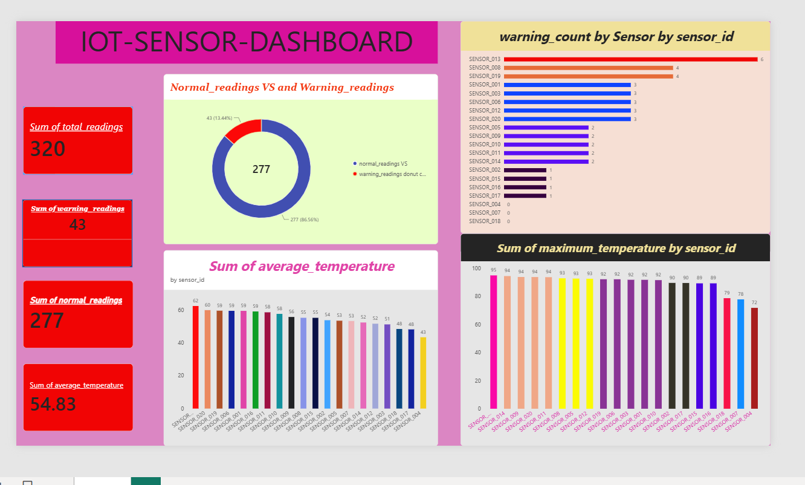

# IoT Sensor Big Data Project

## Overview
A short 2-3 line description of what the project does, for example analyzing IoT sensor data and visualizing it in Power BI.

## Tools Used
- Power BI
- (add others, e.g. Databricks, Spark, Python)

## Dashboard

## Files
- `power bi iot sensor dashboard.pbix` - main Power BI dashboard
- `power bi dashboard model view.pbix` - data model view
